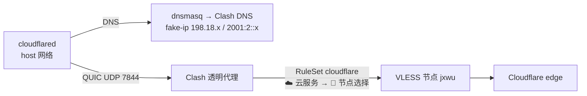

# iStoreOS 部署 Cloudflare Tunnel 与 QUIC 断连排查

本文根据 2026-11-25 的排查记录整理。设备上的 cloudflared 进程一直在运行，但隧道已经断开，挂在隧道后面的服务从公网无法访问。修复方式是改用 `http2` 协议，并把启动参数收回 Docker Compose 管理，避免手动 `docker run` 的参数丢失。

设备、OpenClash 和 Docker 代理的安装过程见 [iStoreOS 安装 OpenClash 与 Docker 代理配置](/pages/b89971)。

## 一、实测环境

| 项目 | 实测值 |
| --- | --- |
| 设备地址 | `192.168.31.2`（旁路由） |
| 系统 | iStoreOS 24.10.5，`aarch64` |
| Docker Compose | `v2.39.1` |
| cloudflared | `2026.11.2`，镜像 `cloudflare/cloudflared:latest` |
| 隧道类型 | 远程托管（Dashboard 配置 ingress，本地只有 token） |
| 代理 | OpenClash（Mihomo），DNS `enhanced-mode: fake-ip` |
| 部署目录 | `/mnt/mmc1-4/cloudflared/` |

`/` 所在的 `/dev/root` 是只读的 squashfs，已经 100% 占用，所以 Compose 项目统一放在数据分区 `/mnt/mmc1-4/` 下，与 `oh-my-cpa`、`openlist`、`subboost` 等项目并列。

## 二、部署

### 1. 创建隧道并取得 token

在 Cloudflare Zero Trust → Networks → Tunnels 创建 `cloudflared` 类型的隧道。创建完成后，页面给出的安装命令里 `--token` 后面那一长串就是隧道 token。之后的 Public Hostname（ingress）都在 Dashboard 里配置，设备上不需要 `config.yml`。

### 2. 编写 Compose 项目

在**设备 SSH**中创建目录：

```bash
mkdir -p /mnt/mmc1-4/cloudflared
cd /mnt/mmc1-4/cloudflared
```

token 写入 `.env`，并限制为仅 root 可读：

```bash
cat > .env <<'EOF'
TUNNEL_TOKEN=<隧道 token>
EOF
chmod 600 .env
```

`compose.yml`：

```yaml
services:
  cloudflared:
    image: cloudflare/cloudflared:latest
    container_name: cloudflared
    command: tunnel --no-autoupdate --metrics 127.0.0.1:20241 --protocol http2 run
    env_file: .env
    network_mode: host
    restart: unless-stopped
```

各项说明：

| 配置 | 原因 |
| --- | --- |
| `TUNNEL_TOKEN` 放在 `.env` | cloudflared 会读取这个环境变量，token 不进命令行和 `compose.yml`，`docker ps` 也看不到 |
| `--protocol http2` | 固定使用 TCP 443 上的 HTTP/2，不用默认的 QUIC。原因见第三节 |
| `--metrics 127.0.0.1:20241` | 只在本机暴露 `/ready` 和 `/metrics`，用于健康检查 |
| `--no-autoupdate` | 容器内不做自更新，升级通过拉取新镜像完成 |
| `network_mode: host` | ingress 指向 `192.168.31.2` 和 `192.168.31.1` 上的服务，用 host 网络可以直接访问 |
| `restart: unless-stopped` | 设备重启或进程退出后自动拉起 |

### 3. 启动与验证

```bash
cd /mnt/mmc1-4/cloudflared
docker compose config -q && echo compose-valid
docker compose up -d
```

等 20～30 秒后检查：

```bash
docker compose ps
curl -s -o /dev/null -w "ready=%{http_code}\n" http://127.0.0.1:20241/ready
curl -s http://127.0.0.1:20241/metrics | grep -E "^cloudflared_tunnel_ha_connections|_server_locations.* 1$"
docker compose logs --tail 20 | grep -E "Registered tunnel connection|ERR"
```

本次实测结果：

```text
cloudflared Up 30 seconds
ready=200
cloudflared_tunnel_ha_connections 2
cloudflared_tunnel_server_locations{connection_id="0",edge_location="lax08"} 1
cloudflared_tunnel_server_locations{connection_id="1",edge_location="lax13"} 1
... Registered tunnel connection connIndex=1 ... location=lax13 protocol=http2
```

`docker compose ls` 中应能看到 `cloudflared  running(1)  /mnt/mmc1-4/cloudflared/compose.yml`。

### 4. 当前 ingress

Dashboard 下发的 ingress 会出现在日志 `Updated to new configuration` 里。本次记录的源站如下，公网域名省略：

| 源站 | 对应服务 |
| --- | --- |
| `http://192.168.31.2:8317` | `cli-proxy-api` |
| `http://192.168.31.2:8080` | `oh-my-cpa` |
| `http://192.168.31.2:9090` | OpenClash 外部控制器 |
| `http://192.168.31.2:80` | iStoreOS 管理页（uhttpd） |
| `http://192.168.31.2:32453` | `subboost-app` |
| `http://192.168.31.1:16601` | 主路由上的服务 |
| `http_status:404` | 兜底规则 |

其中 `:9090` 和 `:80` 是管理面，公开到公网时，建议在 Zero Trust 里加 Access 策略，不要只靠控制器 secret 或登录密码保护。

### 5. 日常运维

```bash
cd /mnt/mmc1-4/cloudflared
docker compose pull && docker compose up -d   # 升级
docker compose restart                        # 重启
docker compose logs -f --tail 50              # 看日志
```

升级、重启都通过 Compose 执行，不要再手写 `docker run`。cloudflared 镜像基于 distroless，没有 `/bin/sh`，`docker exec ... sh` 会失败，Compose 里的 `healthcheck` 也不能用 shell 命令。

## 三、故障：进程在跑，隧道断了

### 1. 现象

- 容器状态 `Up 21 hours`，`RestartCount=0`，从 Docker 层面看不出问题。
- `curl http://127.0.0.1:20241/ready` 返回 **503**。
- 日志里最后一次 `Registered tunnel connection` 出现在 `2026-11-24T19:36Z`（北京时间 11-25 03:36）。到排查时（约 09:15）为止，每隔几秒就出现一次：

```text
ERR Failed to dial a quic connection error="failed to dial to edge with quic: timeout: no recent network activity" connIndex=0 event=0 ip=198.18.0.27
INF Retrying connection in up to 32s connIndex=0 event=0 ip=198.18.0.27
ERR Failed to dial a quic connection error="failed to dial to edge with quic: timeout: no recent network activity" connIndex=0 event=0 ip=2001:2::19
```

- 最近 500 行日志中有 160 行是 `Failed to dial`。cloudflared 一直在重试 QUIC，没有切到 http2。
- `/metrics` 里 `cloudflared_tunnel_ha_connections` 仍然显示 `1`，和 `/ready=503` 互相矛盾。**判断隧道是否健康要看 `/ready`，不能只看这个 gauge。**

### 2. 排查过程

**① 确认进程来源。** 宿主机上的 `cloudflared` 进程（uid 65532）属于 Docker 容器 `cloudflared`，宿主机本身没有安装 cloudflared 二进制，也没有 init 脚本。`/mnt/mmc1-4/cloudflared/compose.yml` 是存在的，但 `docker compose ls` 里没有这个项目。说明当时运行的容器是手动 `docker run` 创建的，Compose 文件没有在用。

**② 发现 edge 地址是 fake-ip。** 日志里连接的 edge 地址是 `198.18.0.27`、`2001:2::19`，属于 OpenClash 的 fake-ip 网段：

```bash
nslookup region1.v2.argotunnel.com
# 198.18.0.6 / 2001:2::4
```

而通过 DoH 查到的真实地址是 `198.41.192.x`、`2606:4700:a0::x`。设备 DNS 经 dnsmasq 转发到 `127.0.0.1#7874`（Clash DNS），容器使用 host 网络，所以 cloudflared 拿到的也是 fake-ip。整条链路是：



Clash 日志也能对应上：`region1.v2.argotunnel.com:443 match RuleSet(cloudflare) using ☁️ 云服务[jxwu]`。

**③ 判断是网络不通还是进程卡住。** 用同一个 token 在旁边启动一个临时连接器 `cf-test`，指定 `--protocol http2`，metrics 端口改为 `20242`，现网容器保持不动：

```bash
TOKEN=$(docker inspect cloudflared --format "{{range .Config.Env}}{{println .}}{{end}}" | sed -n "s/^TUNNEL_TOKEN=//p")
docker run -d --name cf-test --network host -e TUNNEL_TOKEN="$TOKEN" \
  cloudflare/cloudflared:latest \
  tunnel --no-autoupdate --metrics 127.0.0.1:20242 --protocol http2 run
```

新版 cloudflared 启动时会做 precheck，结果如下：

```text
precheck component="UDP Connectivity" details="QUIC connection successful" status=pass target=region1.v2.argotunnel.com
precheck component="TCP Connectivity" details="HTTP/2 connection successful" status=pass target=region1.v2.argotunnel.com
precheck component="Cloudflare API"   details="API is reachable"            status=pass
precheck complete hard_fail=false suggested_protocol=http2
Registered tunnel connection ... location=lax05 protocol=http2
```

临时连接器约 1 秒就注册成功，`/ready=200`。precheck 当时显示 QUIC 也能连通，说明网络本身并没有断。问题在于老进程的 QUIC 连接已经卡住，而它不会自动降级到 http2。

### 3. 根因

| 层 | 结论 |
| --- | --- |
| 直接原因 | cloudflared 默认使用 QUIC（UDP 7844）。QUIC 连接失效后，进程只在 QUIC 上反复重试，数小时没有恢复，也没有回退到 http2 |
| 环境因素 | 出站流量要经过 Clash fake-ip 和 VLESS 节点转发，UDP/QUIC 在这条链路上比 TCP 更容易出现长时间静默失效（推断：失效发生时 VLESS 节点的 UDP 转发异常，事后无法复现） |
| 放大因素 | 容器进程没有退出，`restart: unless-stopped` 不会触发；没有任何监控检查 `/ready`；当时运行的是手动 `docker run` 的容器，参数不在任何文件里 |

### 4. 修复

1. 删除临时连接器，用 `--protocol http2` 重建容器，验证 `ready=200`、`ha_connections=2`。
2. 把 `--protocol http2` 写入 `/mnt/mmc1-4/cloudflared/compose.yml` 的 `command`。删掉手动创建的容器，改用 `docker compose up -d` 启动，见第二节。
3. 确认新容器带有 Compose 标签：

```bash
docker inspect cloudflared --format '{{index .Config.Labels "com.docker.compose.project"}}'
# cloudflared
```

修复后近 60 秒日志中 `ERR` 为 0，两条连接都是 `protocol=http2`。

## 四、排查中的误区

- **`curl https://198.41.192.x/` 失败不能说明 edge 不通。** 在旁路由和 Mac 上直接访问 `198.41.192.27:443` 都返回 `http=000`。这些 IP 是隧道专用的 edge，不提供普通 HTTPS 页面；同一时间 `1.1.1.1`、`104.16.132.229` 都正常返回 `301`。要判断 edge 是否可达，应以 cloudflared 的 precheck 或注册日志为准。
- **`ha_connections` 不等于隧道健康。** 本次故障中它一直是 `1`，而 `/ready` 是 503。
- **OpenClash 的 `QUIC REJECT` 规则与本次故障无关。** nftables 中有 `udp dport 443 ... reject comment "OpenClash QUIC REJECT"`，但它只拦截目的端口为 UDP 443 的流量，cloudflared 的 QUIC 走 UDP 7844，规则计数也为 0。
- **busybox `nc` 不支持 `-z`。** iStoreOS 上只有 busybox 版 `nc`（不支持 `-z`），也没有 `python3`、`jq`。测 TCP 连通性改用 `curl --connect-timeout`；解析 Clash API 的 JSON 时，先把数据拉回 Mac 再处理。

## 五、遗留风险

- **没有基于 `/ready` 的自动恢复。** 镜像里没有 shell，不能在 Compose 中配置 `healthcheck`。如果以后需要，可以在宿主机加 cron，执行 `curl -sf http://127.0.0.1:20241/ready || docker restart cloudflared`。截至本文，这一项**尚未部署**。
- **`latest` 镜像版本不固定。** 每次 `docker compose pull` 都可能拉到新的大版本。需要稳定时，把镜像改为固定版本，如 `cloudflare/cloudflared:2026.11.2`。
- **http2 依赖 TCP 443 出站。** 如果以后要切回 QUIC，必须先确认代理节点的 UDP 转发稳定，并配合 `/ready` 监控。
